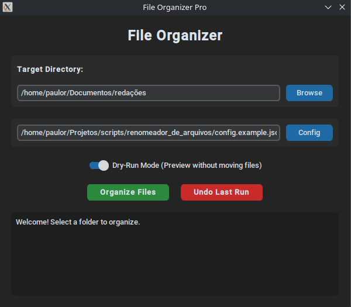

# File Organizer Pro

A Python tool that organizes messy folders (like `Downloads`) by sorting files into category folders based on their extensions. It ships with both a **command-line interface** and a **desktop GUI**, supports **custom rules via JSON**, and can **undo** any run.



## Features

- **Automatic organization** – moves files into `Images/`, `Documents/`, `Code/`, `Archives/`, `Audio/` or `Others/`.
- **Custom rules** – define your own categories and extensions in a JSON file.
- **Dry-run mode** – preview what would happen without touching any file.
- **Undo (rollback)** – every run is logged, so the last organization can be reverted.
- **Safe by design**
  - Name collisions never overwrite files (`report.pdf` → `report_1.pdf`).
  - Subfolders, hidden files and files without extension are left alone.
  - Category names in the config are validated to prevent path traversal (e.g. `"../"`).
- **Tested** – unit tests with `pytest` using temporary directories (`tmp_path`).

## Requirements

- Python 3.10+
- Tcl/Tk (required by Tkinter)
- [CustomTkinter](https://github.com/TomSchimansky/CustomTkinter) (GUI)
- [pytest](https://pytest.org/) (development and testing only)

## Installation

```bash
git clone https://github.com/paulorf98/organizador_de_arquivos.git
cd organizador_de_arquivos

python -m venv .venv
source .venv/bin/activate        # Windows: .venv\Scripts\activate

pip install customtkinter        # needed for the GUI
pip install pytest               # needed to run the tests
```

> The core (`organizer.py`) and the CLI only use the Python standard library.

## Usage

### Graphical interface

```bash
python gui.py
```

1. Click **Browse** and choose the folder to organize.
2. (Optional) Click **Config** to load a custom JSON rules file.
3. (Optional) Enable **Dry-Run Mode** to preview the result.
4. Click **Organize Files**. Use **Undo Last Run** to revert.

### Command line

```bash
python organizer.py --path ~/Downloads
python organizer.py --path ~/Downloads --config config.example.json
python organizer.py --path ~/Downloads --dry-run
python organizer.py --path ~/Downloads --undo
```

| Argument        | Description                                        |
| --------------- | -------------------------------------------------- |
| `-p`, `--path`  | **Required.** Directory to organize.               |
| `-c`, `--config`| JSON file with custom category rules.              |
| `--dry-run`     | Show what would be moved, without moving anything. |
| `--undo`        | Revert the last organization run.                  |

`--undo` and `--dry-run` cannot be combined. The CLI exits with code `0` on success and `1` on error.

## Custom configuration

Create a JSON file mapping each category name to a list of extensions:

```json
{
  "Images": [".jpg", ".png", ".webp"],
  "Books": [".epub", ".mobi"],
  "Videos": [".mp4", ".mkv"]
}
```

- Extensions are case-insensitive, and the leading dot is optional (`"epub"` works).
- Files with an extension that matches no category go to `Others/`.
- If an extension appears in more than one category, the first one wins.
- A ready-to-use example is available in [`config.example.json`](config.example.json).

## How undo works

Each run that moves at least one file is appended to a hidden `.organizer_history.json` inside the organized folder, recording the original and final path of every file. `--undo` reverts the **most recent** run (in reverse order) and removes category folders that become empty.

- Files that were deleted or moved after the run are skipped with a warning.
- If another file took the original name in the meantime, the restored file gets a numeric suffix instead of overwriting it.
- The history file is hidden, so the organizer never moves it.

## Running the tests

```bash
pytest
```

The tests create real files in temporary folders (`tmp_path`) and check that they end up in the right place. They cover classification, name collisions, dry-run, custom config validation, undo and the CLI.

## Project structure

```
.
├── assets/
│   └── screenshot.png
├── organizer.py
├── gui.py
├── config.example.json
├── tests/
├── README.md
└── LICENSE
```

## Roadmap

- [ ] Recursive mode (`--recursive`)
- [ ] Organize by date (`2026/10/`)
- [ ] Ignore list (patterns that should never be moved)
- [ ] YAML config support
- [ ] Package with `pyproject.toml` (`file-organizer` command)

## License

This project is licensed under the MIT License. See the `LICENSE` file for details.# file-organizer
# file-organizer
